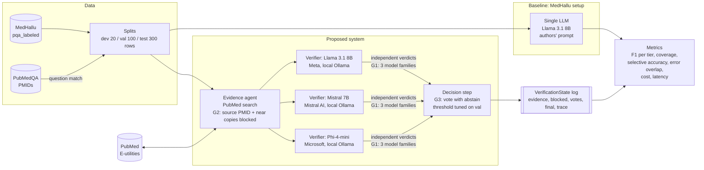

# Architecture

GitHub renders the diagram below. Boxes marked G1, G2 and G3 are where each research gap is addressed.

## How the baseline differs from the proposed system

| | Baseline (MedHallu) | Proposed system |
| --- | --- | --- |
| Judges | 1 model | 3 models from different families, judging separately |
| Evidence | none, or the source abstract | PubMed search with the source blocked (A), or the source abstract (B) |
| Not sure | prompt option only | vote rule with abstention, tuned on the validation split |
| Reported | F1 after dropping "not sure" | F1, coverage, accuracy on answered items, error overlap, cost |

## Structured contracts (`src/medverify/schemas.py`)

| Contract | Holds |
| --- | --- |
| `Row` | One MedHallu row: question, source abstract, true answer, hallucinated answer, difficulty, category, PubMed ID |
| `Item` | One question plus one answer to verify, with its label (1 = hallucinated) |
| `LLMResult` | Raw reply, provider, model, latency, tokens, cache flag |
| `Evidence` / `BlockedEvidence` | Retrieved abstracts, and abstracts removed for leakage (with reason) |
| `Verdict` | One judge's verdict on one item: 0 factual, 1 hallucinated, 2 not sure, or None if unparseable |
| `VerificationState` | The full trajectory for one item in the proposed system |
